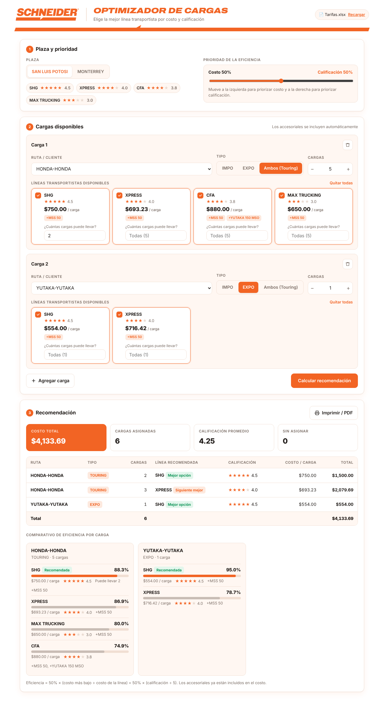

# Optimizador de Cargas

Programa que recomienda **qué línea transportista conviene para cada carga**, buscando el **menor costo** y la **mejor calificación** de la línea.

Lee las tarifas y calificaciones del archivo `Tarifas.xlsx` y se usa desde el navegador, en tu propia computadora (`http://localhost:8000`).



---

## Contenido

1. [Instalar Python (desde cero)](#1-instalar-python-desde-cero)
2. [Descargar el programa](#2-descargar-el-programa)
3. [Abrir el programa](#3-abrir-el-programa)
4. [Cómo usarlo](#4-cómo-usarlo)
5. [Actualizar tarifas y calificaciones](#5-actualizar-tarifas-y-calificaciones)
6. [Cómo se calcula la recomendación](#6-cómo-se-calcula-la-recomendación)
7. [Solución de problemas](#7-solución-de-problemas)
8. [Archivos del proyecto](#8-archivos-del-proyecto)

---

## 1. Instalar Python (desde cero)

El programa necesita **Python 3.9 o más reciente**. Solo se instala una vez.
Sigue los pasos de tu sistema: [Windows](#windows) o [Mac](#mac).

### Windows

1. Entra a **https://www.python.org/downloads/** y haz clic en el botón amarillo **Download Python 3.x**.
2. Abre el archivo descargado (`python-3.x.x-amd64.exe`).
3. **MUY IMPORTANTE:** en la primera pantalla del instalador marca la casilla
   **Add python.exe to PATH** (está abajo).
4. Haz clic en **Install Now** y espera a que termine. Al final haz clic en **Close**.
5. Comprueba la instalación:
   - Presiona la tecla **Windows**, escribe `cmd` y presiona **Enter**.
   - En la ventana negra escribe lo siguiente y presiona Enter:
     ```
     py --version
     ```
   - Debe aparecer algo como `Python 3.13.1`.

> **Si ves el mensaje "no se encontró Python; ejecutar sin argumentos para instalar desde el Microsoft Store…"**
> usa `py` en lugar de `python` en todos los comandos. Ese aviso sale porque Windows tiene un acceso directo a la Microsoft Store.
> Si quieres desactivarlo: **Configuración → Aplicaciones → Configuración avanzada de aplicaciones → Alias de ejecución de aplicaciones** y apaga **python.exe** y **python3.exe**.

### Mac

1. Entra a **https://www.python.org/downloads/** y haz clic en **Download Python 3.x**.
   La página detecta que usas Mac y descarga el instalador `python-3.x.x-macos11.pkg`. Sirve para Mac con chip Intel y con chip Apple (M1, M2, M3, M4).
2. Abre la carpeta **Descargas** y haz doble clic en el archivo `.pkg`.
3. En el instalador haz clic en **Continuar** → **Continuar** → **Aceptar** → **Instalar**.
   Te pedirá la **contraseña de tu Mac** (o Touch ID). Espera a que termine y haz clic en **Cerrar**.
4. Al terminar se abre una carpeta llamada **Python 3.x**. Haz doble clic en **`Install Certificates.command`**.
   Se abre una ventana de Terminal, hace la configuración sola y la puedes cerrar cuando diga `process completed`.
   (Esto permite que Python descargue la librería que usa el programa.)
5. Comprueba la instalación:
   - Presiona **Cmd + Espacio**, escribe `Terminal` y presiona **Enter**.
   - En la Terminal escribe lo siguiente y presiona Enter:
     ```
     python3 --version
     ```
   - Debe aparecer algo como `Python 3.13.1`.

> **En Mac siempre se usa `python3`** (no `python`).
>
> **Si al escribir `python3` aparece una ventana pidiendo instalar las "herramientas de desarrollo de línea de comandos"**,
> significa que todavía no se instaló Python desde python.org. Haz clic en **Cancelar** y repite los pasos 1 a 4.

## 2. Descargar el programa

**Opción fácil (sin Git):**

1. En esta página de GitHub haz clic en el botón verde **`<> Code`** → **Download ZIP**.
2. Descomprime el archivo:
   - **Windows:** en tu carpeta **Descargas**, clic derecho sobre el ZIP → **Extraer todo…** → **Extraer**.
   - **Mac:** en tu carpeta **Descargas**, haz doble clic en el ZIP (Safari a veces lo descomprime solo).
3. Te quedará una carpeta llamada `optimizador-cargas-main`. Puedes moverla a donde quieras (por ejemplo, al Escritorio o a Documentos).

**Opción con Git** (si ya lo tienes instalado):
```bash
git clone https://github.com/LeoCas4/optimizador-cargas.git
```

---

## 3. Abrir el programa

### Windows: doble clic (recomendado)

1. Entra a la carpeta del programa.
2. Haz **doble clic** en **`Abrir Optimizador.bat`**.
3. La primera vez instalará automáticamente lo que necesita (tarda unos segundos).
4. Se abrirá el navegador con el programa. Si no se abre solo, entra a **http://localhost:8000**.
5. **No cierres la ventana negra** mientras uses el programa. Para salir, ciérrala (o presiona `Ctrl + C`).

> Si Windows muestra "Windows protegió su PC", haz clic en **Más información → Ejecutar de todas formas**.

### Windows: con comandos (alternativa)

1. Abre la carpeta del programa en el Explorador de archivos.
2. Haz clic en la barra de direcciones (arriba), escribe `cmd` y presiona **Enter**. Se abre una ventana negra ya ubicada en la carpeta.
3. **Solo la primera vez**, instala la librería para leer Excel:
   ```
   py -m pip install -r requirements.txt
   ```
4. Abre el programa:
   ```
   py app_web.py
   ```

### Mac: doble clic (recomendado)

1. Entra a la carpeta del programa.
2. **La primera vez:** haz **clic derecho** (o Control + clic) sobre **`Abrir Optimizador.command`** → **Abrir** → en el aviso vuelve a hacer clic en **Abrir**.
   Esto es necesario porque macOS bloquea los archivos descargados de internet la primera vez.
   Las siguientes veces basta con hacer **doble clic**.
3. Se abre una ventana de Terminal. La primera vez instalará lo que necesita (tarda unos segundos).
4. Se abrirá el navegador con el programa. Si no se abre solo, entra a **http://localhost:8000**.
5. **No cierres la ventana de Terminal** mientras uses el programa. Para salir, presiona `Ctrl + C` en la Terminal y luego ciérrala.

> Si macOS dice **"no se puede abrir porque proviene de un desarrollador no identificado"** y no aparece el botón Abrir:
> ve a **Configuración del Sistema → Privacidad y seguridad**, baja hasta el mensaje de `Abrir Optimizador.command` y haz clic en **Abrir de todas formas**.
>
> Si dice **"no tienes permiso"** o el archivo se abre en un editor de texto, sigue los pasos "con comandos" de abajo.
> Una vez dentro de la carpeta en la Terminal, también puedes repararlo con `chmod +x "Abrir Optimizador.command"`.

### Mac: con comandos (alternativa)

1. Abre **Terminal** (Cmd + Espacio → escribe `Terminal` → Enter).
2. Escribe `cd` seguido de **un espacio**, luego **arrastra la carpeta del programa** desde el Finder hasta la ventana de Terminal y presiona **Enter**.
   Debe verse algo así:
   ```
   cd /Users/tu-usuario/Downloads/optimizador-cargas-main
   ```
   > Otra forma: en el Finder haz clic derecho sobre la carpeta → **Servicios** → **Nuevo Terminal en la carpeta**.
3. **Solo la primera vez**, instala la librería para leer Excel:
   ```
   python3 -m pip install -r requirements.txt
   ```
4. Abre el programa:
   ```
   python3 app_web.py
   ```
5. Se abre el navegador en **http://localhost:8000**. Para salir, presiona `Ctrl + C` en la Terminal.

**Las siguientes veces** solo necesitas los pasos 1, 2 y 4.

### Versión de consola (sin navegador)

También existe una versión que funciona solo con preguntas en la ventana negra:
- Windows:
  ```
  py optimizador_cargas.py
  ```
- Mac:
  ```
  python3 optimizador_cargas.py
  ```

---

## 4. Cómo usarlo

**Paso 1: Plaza y prioridad**
- Elige la plaza: **San Luis Potosí** o **Monterrey**. Verás las líneas de esa plaza con su calificación.
- Con la barra puedes dar más peso al **costo** (izquierda) o a la **calificación** (derecha). Por defecto es 50 % / 50 %.

**Paso 2: Cargas disponibles**
- **Ruta / cliente:** por ejemplo, HONDA-HONDA.
- **Tipo:** IMPO, EXPO o Ambos (Touring).
- **Cargas:** cuántas cargas tienes de esa ruta.
- **Líneas transportistas disponibles:** marca solo las líneas que tienes disponibles. Cada tarjeta muestra el costo por carga con los accesoriales incluidos.
- Si una línea solo puede llevar algunas cargas, escribe cuántas en **¿Cuántas cargas puede llevar?**. Si lo dejas vacío, se considera que puede llevar todas.
- **HAZMAT:** la casilla solo aparece en las rutas que tienen tarifa especial HAZMAT.
- Con **+ Agregar carga** capturas otra ruta.

**Paso 3: Recomendación**
- Presiona **Calcular recomendación**.
- Verás el **costo total**, las **cargas asignadas**, la **calificación promedio**, la tabla con la **línea recomendada** para cada carga y un comparativo de eficiencia de todas las líneas.
- Con **Imprimir / PDF** puedes guardar o compartir el resultado.

---

## 5. Actualizar tarifas y calificaciones

Todo se lee de **`Tarifas.xlsx`**, así que **no necesitas modificar el código** para cambiar precios.

- Edita el Excel y guárdalo (con el mismo nombre y en la misma carpeta).
- En el programa, haz clic en **Recargar** (arriba a la derecha).

Reglas del formato del Excel:
- Cada plaza va en una fila con su nombre (`SAN LUIS POTOSÍ`, `MONTERREY`).
- Cada línea transportista va en una fila con su nombre, seguida de la fila de encabezados `CLIENTE | IMPO | EXPO | TARIFA COMPLETA | ACCESORIAL EXPO | ACCESORIAL IMPO` y de sus rutas.
- Si varias líneas aparecen seguidas sin tabla entre ellas (como `MAX TRUCKING`, `SMART LOGISTICS` y `LEADS` en Monterrey), **comparten la tabla que viene debajo**.
- `NA` significa que esa línea solo cotiza la tarifa completa.
- Las calificaciones se escriben como `NOMBRE- 4.5` (por ejemplo, `XPRESS- 4`). Para Max Trucking se usan `Max trucking SLP` y `Max trucking SAVI` (Monterrey).

Para usar otro archivo de Excel:
- Windows:
  ```
  py app_web.py "C:\ruta\a\OtroArchivo.xlsx"
  ```
- Mac:
  ```
  python3 app_web.py "/Users/tu-usuario/Documents/OtroArchivo.xlsx"
  ```

---

## 6. Cómo se calcula la recomendación

**Costo por carga**
| Tipo | Tarifa usada |
|---|---|
| IMPO | columna IMPO + accesorial IMPO |
| EXPO | columna EXPO + accesorial EXPO (p. ej. MSS 50) |
| Ambos (Touring) | TARIFA COMPLETA + accesoriales EXPO e IMPO |

- Los accesoriales se suman siempre que la ruta los tenga.
- **HAZMAT:** si la carga es HAZMAT, se usa la tarifa HAZMAT en lugar de la tarifa normal (p. ej. Ford en Monterrey con ALASA: $754 en vez de $580).

**Eficiencia (0 a 100 %)**, solo entre las líneas que marcaste como disponibles:

```
Eficiencia = %costo × (costo más bajo ÷ costo de la línea) + %calificación × (calificación ÷ 5)
```

Las cargas se asignan primero a la línea más eficiente. Si esa línea no puede llevarlas todas, el resto pasa a la siguiente mejor.

---

## 7. Solución de problemas

### Windows

| Problema | Solución |
|---|---|
| `no se encontró Python…` o `python no se reconoce…` | Usa `py` en lugar de `python`. Si `py` tampoco funciona, reinstala Python marcando **Add python.exe to PATH**. |
| `No module named openpyxl` o `Falta la librería openpyxl` | Ejecuta `py -m pip install -r requirements.txt` dentro de la carpeta del programa. |
| "Windows protegió su PC" al abrir el `.bat` | Clic en **Más información → Ejecutar de todas formas**. |
| El puerto 8000 está ocupado (`Address already in use`) | El programa ya está abierto en otra ventana. Ciérrala, o usa otro puerto: `set PORT=8001` y luego `py app_web.py`. |

### Mac

| Problema | Solución |
|---|---|
| `command not found: python3` o aparece la ventana de "herramientas de desarrollo" | Instala Python desde python.org (sección 1, Mac). |
| `No module named openpyxl` o `Falta la librería openpyxl` | Ejecuta `python3 -m pip install -r requirements.txt` dentro de la carpeta del programa. |
| `SSL: CERTIFICATE_VERIFY_FAILED` al instalar | Abre **Aplicaciones → Python 3.x** y haz doble clic en **`Install Certificates.command`**. Luego repite la instalación. |
| `error: externally-managed-environment` | Tu Python es de Homebrew. Instala Python desde python.org (sección 1, Mac) o usa `python3 -m pip install --user -r requirements.txt`. |
| "No se puede abrir… desarrollador no identificado" | Clic derecho → **Abrir**, o **Configuración del Sistema → Privacidad y seguridad → Abrir de todas formas**. |
| `Abrir Optimizador.command` se abre como texto o dice "permiso denegado" | En la Terminal, dentro de la carpeta: `chmod +x "Abrir Optimizador.command"`. |
| El puerto 8000 está ocupado (`Address already in use`) | El programa ya está abierto en otra Terminal. Ciérrala, o usa otro puerto: `PORT=8001 python3 app_web.py`. |

### Ambos

| Problema | Solución |
|---|---|
| `No se encontró el archivo de tarifas` | Revisa que `Tarifas.xlsx` esté en la misma carpeta que `app_web.py`. |
| La página dice "No hay conexión con el programa" | La ventana negra (o la Terminal) se cerró. Vuelve a abrir el programa. |
| No aparece el logo | Revisa que exista `web/logo.png`. |
| El Excel no se actualiza | Guarda y **cierra** el Excel, luego presiona **Recargar** en la página. |

---

## 8. Archivos del proyecto

```
optimizador-cargas/
├── Abrir Optimizador.bat       ← doble clic para abrir (Windows)
├── Abrir Optimizador.command   ← doble clic para abrir (Mac)
├── app_web.py                  ← servidor de la interfaz web (localhost:8000)
├── optimizador_cargas.py       ← lógica de cálculo + versión de consola
├── Tarifas.xlsx                ← tarifas y calificaciones
├── requirements.txt            ← librerías necesarias (openpyxl)
├── web/
│   ├── index.html              ← interfaz
│   └── logo.png
└── docs/
    └── captura.png
```
